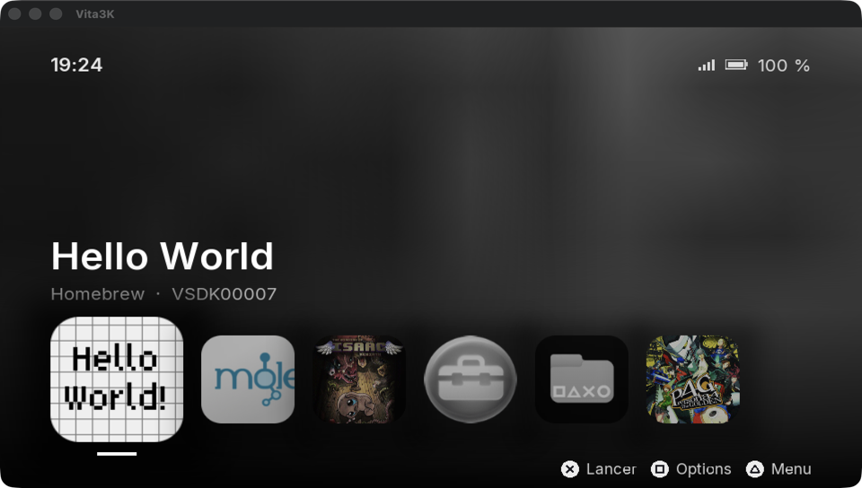
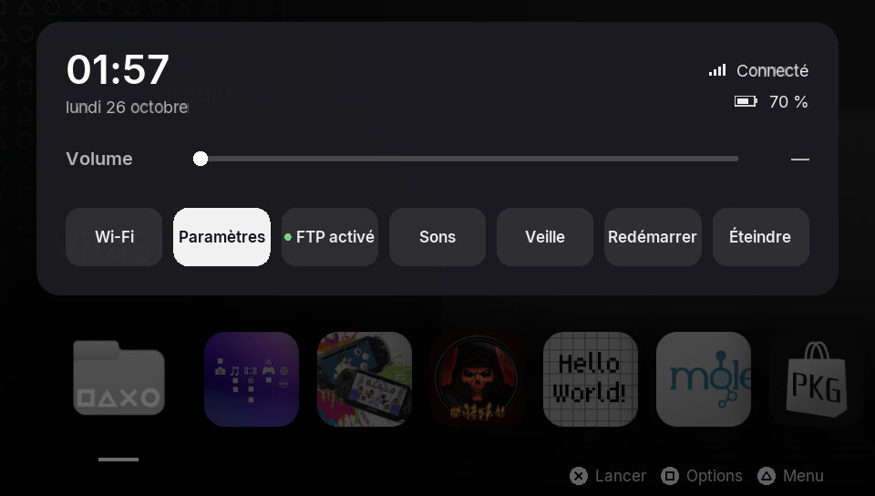
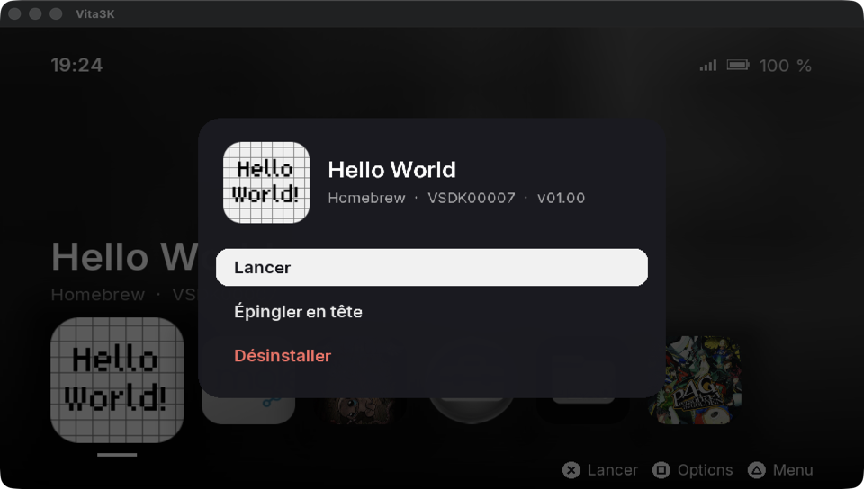

# Vita Launcher

Un launcher pour PS Vita modifiée, inspiré de l'écran d'accueil de la PS5.
*A PS5-style home screen homebrew for the PS Vita.*





## Fonctionnalités

- **Accueil** : rangée des applis installées. L'icône sélectionnée grossit, le fond prend sa couleur dominante et une version floue de son icône. Les applis épinglées passent en tête, puis les dernières lancées, puis le reste par ordre alphabétique.
- **Jaquettes** : les jeux dont l'icône est illisible (chiffrée, comme pour les jeux du commerce) reçoivent leur jaquette, téléchargée en arrière-plan depuis la base [HexFlow-Covers](https://github.com/Andiweli/HexFlow-Covers) et gardée en cache.
- **Fiche d'appli** (▢) : version et identifiant, lancer, épingler en tête, désinstaller (avec confirmation).
- **Panneau rapide** (△ ou glisser depuis le haut de l'écran) : heure et date, Wi-Fi, batterie et autonomie, volume, raccourcis vers les Paramètres et le Wi-Fi, veille, redémarrage et extinction (avec confirmation).
- **Commandes** : croix ou joystick gauche pour naviguer, L/R pour sauter de 5, ✕ pour lancer, aides affichées en bas de l'écran. Au tactile : toucher pour sélectionner, toucher à nouveau pour lancer, glisser pour défiler.
- Les icônes se chargent progressivement, le démarrage reste rapide même avec beaucoup d'applis. Les titres japonais, chinois ou coréens utilisent la police système de la Vita.

Réglages enregistrés dans `ux0:data/vita-launcher/` (épinglées, récentes, cache des jaquettes).

## État

En développement. Testé dans l'émulateur [Vita3K](https://vita3k.org), **pas encore sur une vraie console** : le lancement des applis, le volume, l'alimentation, la désinstallation et la police japonaise restent à valider sur le matériel.

## Prérequis

Une PS Vita sous HENkaku/Ensō avec *Enable Unsafe Homebrew* activé dans les paramètres HENkaku.

## Compiler

Avec [VitaSDK](https://vitasdk.org) installé (`VITASDK` défini) et ses paquets `libvita2d`, `freetype` et `curl-mbedtls` (`vdpm install libvita2d freetype curl-mbedtls`) :

```sh
cmake -S . -B build && cmake --build build
```

Le paquet à installer avec VitaShell est `build/launcher.vpk`.

## Aperçu sur Mac avec Vita3K

```sh
tools/pull-preview.sh 192.168.1.10:1337   # récupère nom et icône des applis de la console (FTP de VitaShell)
tools/preview.sh                          # compile, lance dans Vita3K, capture dans build-preview/shot.png
tools/preview.sh panel                    # pareil, panneau rapide ouvert
tools/preview.sh sheet                    # pareil, fiche de la première appli ouverte
```

Vita3K doit être dans `~/Applications`. Les images de la bulle se régénèrent avec `python3 tools/make_assets.py` (pngquant requis : la Vita exige des PNG 8 bits indexés).

## Tests

```sh
cc test/test_sfo.c src/sfo.c -o build/test_sfo && build/test_sfo
cc test/test_idlist.c src/idlist.c -o build/test_idlist && build/test_idlist
```

## Suite prévue

- Jeux PSP et PS1 (via Adrenaline)
- Boutique : catalogue VitaDB, installation et mises à jour
- Plugin pour revenir au launcher en quittant un jeu, lancement au démarrage

## Licence

MIT, voir [LICENSE](LICENSE). Police [Inter](https://rsms.me/inter/) sous SIL Open Font License 1.1 (`fonts/OFL.txt`). Certificats racines de Mozilla (`certs/cacert.pem`, MPL 2.0, via [curl](https://curl.se/docs/caextract.html)). Jaquettes de [HexFlow-Covers](https://github.com/Andiweli/HexFlow-Covers), téléchargées à l'usage et non incluses. Construit avec [VitaSDK](https://vitasdk.org), [vita2d](https://github.com/xerpi/libvita2d) et libcurl.
