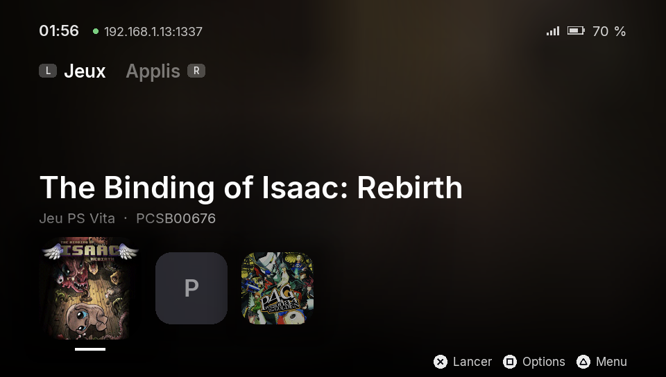
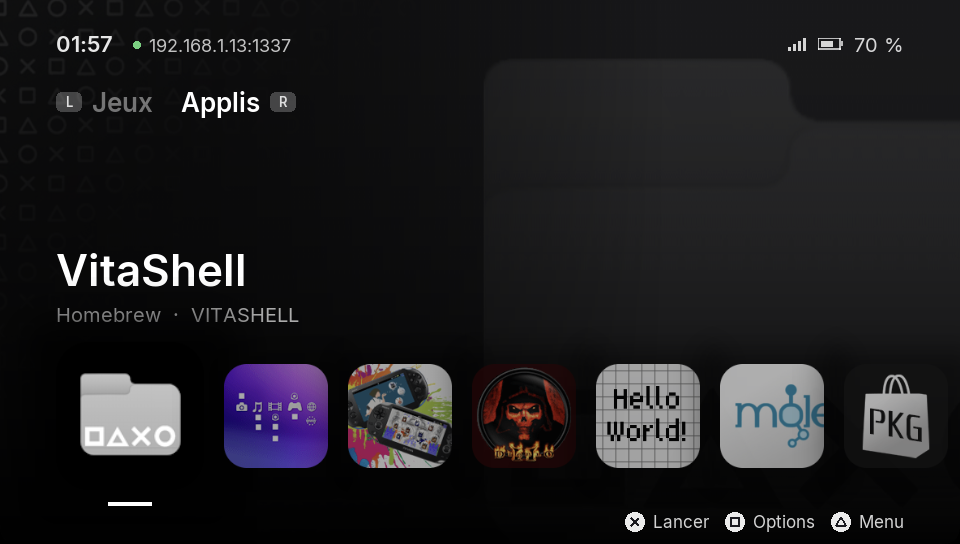
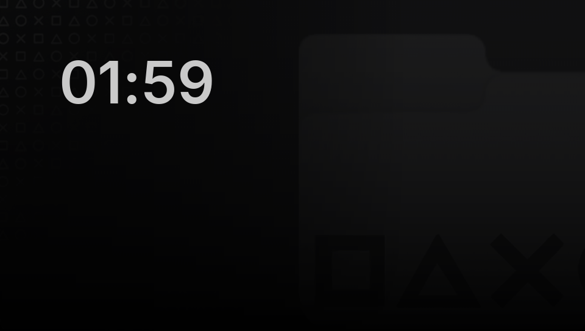

<h1 align="center">Vita Launcher</h1>

<p align="center">
  Un écran d'accueil façon PS5 pour PS Vita modifiée.<br>
  <em>A PS5-style home screen homebrew for the PS Vita.</em>
</p>

<p align="center">
  
  
  <a href="LICENSE"></a>
</p>

<p align="center">
  
</p>

<table>
  <tr>
    <td width="50%"><br><sub><b>Grande image de fond</b> : celle de l'appli, quand elle est lisible</sub></td>
    <td width="50%"><br><sub><b>Panneau rapide</b> (△) : volume, FTP, sons, veille, extinction</sub></td>
  </tr>
  <tr>
    <td><br><sub><b>Fiche d'appli</b> (▢) : lancer, épingler, désinstaller</sub></td>
    <td><br><sub><b>Écran de veille</b> : après une minute sans rien toucher</sub></td>
  </tr>
</table>

## Fonctionnalités

### Accueil

- **Deux onglets**, Jeux et Applis, chacun avec sa rangée. Les applis épinglées passent en tête, puis les dernières lancées, puis le reste par ordre alphabétique.
- **Le fond suit l'appli sélectionnée** : sa couleur dominante et une version floue de son icône, ou sa grande image quand elle est lisible (homebrews et bulles PSP : `pic0.png`, sinon le fond de la LiveArea). Il bouge légèrement quand on incline la console.
- **Sous le titre** : type, identifiant et temps de jeu, noté par le plugin de démarrage.
- **Jaquettes** : les jeux dont l'icône est illisible (chiffrée, comme pour les jeux du commerce) reçoivent leur jaquette, téléchargée en arrière-plan depuis [HexFlow-Covers](https://github.com/Andiweli/HexFlow-Covers) et gardée en cache.
- **Démarrage rapide** même avec beaucoup d'applis : les icônes arrivent progressivement. Les titres japonais, chinois ou coréens utilisent la police système de la Vita.

### Jeux

- **PS Vita** : les jeux installés, avec leur jaquette.
- **PSP** : par les bulles d'Adrenaline Bubble Manager.
- **GBA et PS1** : les ROMs déposées dans `ux0:roms/gba` et `ux0:roms/ps1` se lancent dans RetroArch (cœurs gpSP et PCSX ReARMed), avec les jaquettes de [libretro-thumbnails](https://github.com/libretro-thumbnails).

### Confort

- **Sons** : petits sons de navigation, d'ouverture et de lancement, synthétisés par le launcher. La tuile Sons du panneau les coupe.
- **Écran de veille** : après une minute sans rien toucher, l'interface s'efface, le fond dérive lentement et l'heure se promène, pour ne pas marquer l'écran OLED. Le premier appui ne fait que le réveiller.
- **Aucun appui perdu** : un appui bref pendant une image lente, ou gauche puis droite enchaînés sans repasser par le neutre, comptent toujours.

### Système

- **Panneau rapide** (△, ou glisser depuis le haut de l'écran) : heure et date, Wi-Fi, batterie et autonomie, volume, raccourcis vers les Paramètres et le Wi-Fi, FTP, sons, veille, redémarrage et extinction (avec confirmation).
- **FTP intégré** : transférer des fichiers sans passer par VitaShell, tant que le launcher est ouvert. L'adresse s'affiche à côté de l'heure. Seules les partitions utiles sont exposées (ux0, ur0, uma0, imc0, grw0, ud0), jamais les partitions système. Le serveur repart tout seul après une mise en pause (bouton PS, veille).
- **Interface principale** (plugin optionnel `launcher_boot.suprx`) : le launcher démarre avec la console et revient tout seul quand on quitte un jeu ou une appli. Si on ferme le launcher lui-même, on reste sur l'accueil Sony.

Les réglages sont retenus dans `ux0:data/vita-launcher/` : épinglées, récentes, temps de jeu, FTP, sons, cache des jaquettes.

## Commandes

| Commande | Action |
| --- | --- |
| Croix, joystick gauche | Naviguer |
| L / R | Changer d'onglet |
| ✕ | Lancer |
| ▢ | Fiche de l'appli |
| △ | Panneau rapide |
| ◯ | Fermer le panneau ou la fiche |
| Toucher une icône | La sélectionner, toucher à nouveau pour lancer |
| Glisser | Faire défiler la rangée ; depuis le haut de l'écran, ouvrir le panneau |

## Installation

Il faut une PS Vita sous HENkaku/Ensō, avec *Enable Unsafe Homebrew* activé dans les paramètres HENkaku.

1. [Compiler](#compiler), puis installer `build/launcher.vpk` avec VitaShell.
2. Facultatif : en faire l'interface principale (ci-dessous).

### En faire l'interface principale

Copier `build/launcher_boot.suprx` dans `ur0:tai/`, puis ajouter cette ligne sous `*main` dans `ur0:tai/config.txt` (garder une copie de l'ancien fichier) et redémarrer :

```
*main
ur0:tai/launcher_boot.suprx
```

Le plugin attend que l'accueil soit prêt (même méthode qu'[AutoBoot](https://github.com/Rinnegatamante/AutoBoot)), lance le launcher, puis le relance chaque fois qu'une autre appli se ferme. C'est aussi lui qui lance les applis choisies dans le launcher : il ferme le launcher puis démarre l'appli, ce qui évite la confirmation « fermer l'appli en cours ? » de l'accueil Sony. L'accueil Sony reste visible environ 2 secondes entre les deux : le système ignore les lancements pendant ce temps.

> [!TIP]
> En cas de souci au démarrage : éteindre, rallumer en maintenant L jusqu'à l'accueil (les plugins ne se chargent pas), puis retirer la ligne.

## Développement

### Compiler

Avec [VitaSDK](https://vitasdk.org) installé (`VITASDK` défini) et ses paquets `libvita2d`, `freetype` et `curl-mbedtls` (`vdpm install libvita2d freetype curl-mbedtls`) :

```sh
cmake -S . -B build && cmake --build build
```

### Mettre à jour sur la console

Avec le plugin installé et le FTP du launcher allumé :

```sh
tools/deploy.sh 192.168.1.10:1337
```

Le script compile, dépose le nouvel `eboot.bin` dans `ux0:data/vita-launcher/` et envoie la commande FTP `RELOAD`. Le dossier d'une appli étant verrouillé tant qu'elle tourne, c'est le plugin qui ferme le launcher, met le fichier en place (l'ancien est remis en cas d'échec, résultat dans `update.log`) et le relance. Le script vérifie ensuite que la console a bien la nouvelle version. Les changements d'images ou de polices demandent toujours le VPK.

### Aperçu sur Mac avec Vita3K

```sh
tools/pull-preview.sh 192.168.1.10:1337   # récupère nom et icône des applis de la console (FTP de VitaShell)
tools/preview.sh                          # compile, lance dans Vita3K, capture dans build-preview/shot.png
tools/preview.sh panel                    # pareil, panneau rapide ouvert
tools/preview.sh sheet                    # pareil, fiche de la première appli ouverte
tools/preview.sh 80                       # capture après 80 s : écran de veille
```

Vita3K doit être dans `~/Applications`. Il prend le clavier à son lancement : taper ailleurs pendant une capture peut déplacer la sélection. Les images de la bulle se régénèrent avec `python3 tools/make_assets.py` (pngquant requis : la Vita exige des PNG 8 bits indexés).

### Tests

```sh
cc test/test_sfo.c src/sfo.c -o build/test_sfo && build/test_sfo
cc test/test_idlist.c src/idlist.c -o build/test_idlist && build/test_idlist
cc -idirafter $VITASDK/arm-vita-eabi/include test/test_input.c src/input.c -o build/test_input && build/test_input
```

## État

En développement. Tourne sur une vraie PS Vita (PCH-2000, 3.60 HENkaku) : affichage, icônes, jaquettes, lancement des applis, plugin de démarrage et sons validés. Le volume, l'alimentation, la désinstallation, la police japonaise, l'effet d'inclinaison (sens et amplitude) et la grande image de fond restent à valider sur le matériel.

### Suite prévue

- Jeux PSP sans bulle (ISO lancés directement dans Adrenaline)
- Page « Ta semaine » : temps de jeu cumulé, jeu le plus joué
- Boutique : catalogue VitaDB, installation et mises à jour
- Bouton PS qui ramène au launcher plutôt qu'à l'accueil Sony

## Licence et crédits

MIT, voir [LICENSE](LICENSE).

- Police [Inter](https://rsms.me/inter/) sous SIL Open Font License 1.1 (`fonts/OFL.txt`).
- Certificats racines de Mozilla (`certs/cacert.pem`, MPL 2.0, via [curl](https://curl.se/docs/caextract.html)).
- Jaquettes de [HexFlow-Covers](https://github.com/Andiweli/HexFlow-Covers) et [libretro-thumbnails](https://github.com/libretro-thumbnails), téléchargées à l'usage et non incluses.
- Serveur FTP [libftpvita](https://github.com/xerpi/libftpvita) de Sergi Granell (MIT, `third_party/ftpvita/LICENSE`, en-tête adapté au VitaSDK récent).
- Construit avec [VitaSDK](https://vitasdk.org), [vita2d](https://github.com/xerpi/libvita2d) et libcurl.
